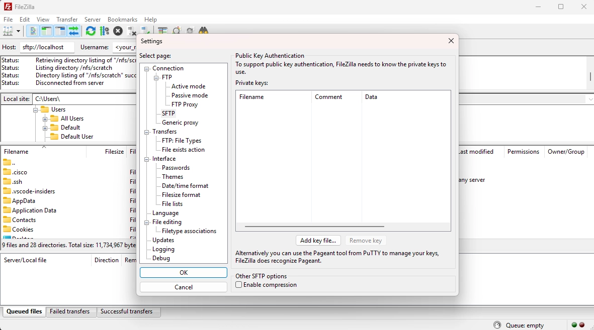
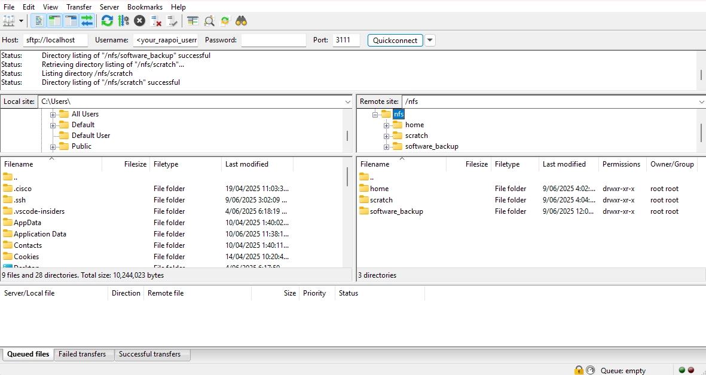

## Bigger Data Transfer Using a Compute Node

!!! Tip
    Windows users are recommended to use Windows Terminal (PowerShell) in Windows 11 or [`Git Bash`](https://git-scm.com/downloads) for the following instructions to work.

Users should install the FileZilla Client from the official webpage.

**Step 1**. Download and install Microsoft Visual Studio Code from https://code.visualstudio.com/download.

**Step 2**. Now you need to create SSH keys on your local machine, _(existing SSH keys can also be used — no need to create new ones. If you already have SSH keys set up, go to Step 3)_ and upload them to Rāpoi. The detailed instructions for creating the SSH keys are given below:

- If you are a Windows user, click Start and search for "Terminal" or "PowerShell" and open it. Mac users can open the Terminal app.
- Type `cd` and press Enter to go to the user's home directory. My username is `ali` in the example below:

```bash
C:\Windows\System32> cd
```

- Then enter the `.ssh` directory by typing:

```bash
C:\Users\ali> cd .ssh
```

- Now type `ssh-keygen` and press Enter:

```bash
C:\Users\ali\.ssh> ssh-keygen
```

- Follow the prompts in the terminal to generate the SSH key pair. When it asks for the file to save the key, you can give a different name, otherwise you can keep the default one, i.e. `id_ed25519`.

```bash
C:\Users\ali\.ssh> ssh-keygen
Generating public/private ed25519 key pair.
Enter file in which to save the key (C:\Users\ali/.ssh/id_ed25519):
Enter passphrase (empty for no passphrase):
Enter same passphrase again:
Your identification has been saved in C:\Users\ali/.ssh/id_ed25519
Your public key has been saved in C:\Users\ali/.ssh/id_ed25519.pub
The key fingerprint is:
SHA256:Dc7PcRDKmdKDETrX0+FK7B1IizHxxMP1C2jdOEr3HH8 ali@mypc
```

- If you type `ls`, you'll see two files, `id_ed25519` and `id_ed25519.pub`, in the current directory. We need to upload the public key `id_ed25519.pub` to Rāpoi.

- Send the _public_ key to _Rāpoi_
    - For macOS and Linux users, or Windows users using Git Bash when already inside the `.ssh` directory. Replace `RAAPOI_USERNAME` with your actual Rāpoi username:

        ```bash
        user@local:~$ ssh-copy-id -i id_ed25519 RAAPOI_USERNAME@raapoi.vuw.ac.nz
        ```

    - For Windows users using Windows Terminal or PowerShell. Replace `RAAPOI_USERNAME` with your actual Rāpoi username:

        ```bash
        C:\Users\ali\.ssh> type .\id_ed25519.pub | ssh RAAPOI_USERNAME@raapoi.vuw.ac.nz "mkdir -p ~/.ssh && cat >> ~/.ssh/authorized_keys"
        ```

Now it's time to test the new SSH keys. Try logging in as shown below and it should not ask you for your Rāpoi password.

- For macOS and Linux users, or Windows users using Git Bash when already inside the `.ssh` directory. Replace `RAAPOI_USERNAME` with your actual Rāpoi username:

  ```bash
  user@local:~$ ssh -i ~/.ssh/id_ed25519 RAAPOI_USERNAME@raapoi.vuw.ac.nz
  ```

- For Windows users using Windows Terminal or PowerShell. Replace `RAAPOI_USERNAME` with your actual Rāpoi username:

  ```bash
  C:\Users\ali\.ssh> ssh -i id_ed25519 RAAPOI_USERNAME@raapoi.vuw.ac.nz
  ```

If it logs in successfully, it means that the SSH keys are working correctly.

**Step 3**. Add your SSH key inside the FileZilla client. Go to Edit > Settings > select SFTP under Connection. Click on Add key file… and select your private key from the file browser window.

    

**Step 4**. On your local machine, open a terminal window (Windows Terminal, Windows PowerShell, Git Bash, etc.), then start an _SSH tunnel_ using local forwarding by typing the following command:

```bash
ssh -L 3111:amd01n04:22 <your_raapoi_username>@raapoi.vuw.ac.nz
```

Once logged in, allocate resources using the same terminal. You'll see the `USERNAME@raapoi-login` change to `USERNAME@amd01n04`.

```bash
RAAPOI_USERNAME@raapoi-login:~$ srun --partition=quicktest --nodelist=amd01n04 --cpus-per-task=2 --mem=4G --time=05:00:00 --pty bash
srun: job 3497952 queued and waiting for resources
srun: job 3497952 has been allocated resources
RAAPOI_USERNAME@amd01n04:~$
```

**Step 5**. Connect the FileZilla session.

- Now is the time to connect FileZilla to the interactive session we just got on Rāpoi. Follow the instructions below:

    - Enter these details in the QuickConnect bar inside the FileZilla client window:

    Host: `sftp://127.0.0.1`
    Username: `<your_raapoi_username>`
    Password: `<leave_empty>`
    Port: `3111`

    

    - Then choose `QuickConnect`.

    - Once a connection is established, you'll see the local and remote files and folders. You can drag and drop files to and from Rāpoi.

!!! Tip
    The instructions above assume that the node `amd01n04` is up and has sufficient resources available. There may be times when this is not the case and you need to adapt these steps to access CPUs on a different node. As a workaround, you'll need to modify Step 4 to point towards a different node.

